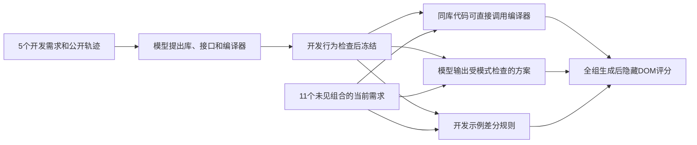

# 开发需求建库与未见组合

这是独立合成诊断，**不是官方Web-Bench成绩**。应用灵感来自calculator/table；需求、四个二元行为维度、DOM契约与断言由本研究编写，模型提出接口、状态和整页实现。冻结协议见 [PROTOCOL.md](PROTOCOL.md)，结果见 [../../实验结果.md](../../实验结果.md) 第19节。

每应用16种配置中，基础与四个单项变化构成5个开发需求；其余11个为未见组合。四库首次通过开发行为检查即冻结。两规划者产生220个主候选，GPT-5 medium另做24个预选组合候选；全部生成结束后才评分。



无库代码也看开发信息；两同库做法的用户消息逐字相同。五个固定开发示例、固定最终配置与无模型差分合成在调用前指定。所有配置的隐藏动作序列相同、地址没有配置ID，16种期望轨迹不同，以防固定页从动作序列推断答案。

只读复核与文档生成（不调用模型）：

```bash
uv run python -m test.heldout_composition.analyze
uv run python -m test.heldout_composition.diagnostics
uv run python -m test.heldout_composition.report
uv run python -m test.heldout_composition.paper_tables
uv run python -m test.replay_new_tables
```

`analyze`核对原工作区冻结哈希、原始请求/输出、开发包与评分；匿名重写包应改用自己的清单与`replay_new_tables`，不能要求原始字节哈希通过。

仅在缺评分时补本地浏览器执行（有缓存时不覆盖）：

```bash
uv run python -m test.heldout_composition.evaluate
uv run python -m test.heldout_composition.controls
```

现有生成已结束，三个账本stop=0。不要直接重新运行`prepare`、`run build/run/strong`或修改冻结文件来继续采样。清单绑定`domain/fixtures/browser/reference/prepare/core/run/evaluate/controls`、公开开发资料、协议及复用的编译器；新的方法或需求需要新阶段。开发参考校准的旧草稿、失败传输及未确认收费均保留。

目前明确的是四库能复用到这些未见组合。还不能确认的是非模板需求迁移或模型规划必要性：方案与同库代码均88/88，规则差分也44/44。五个开发示例各0/44与固定最终页8/88证明需要随需求选择，却不能证明选择需要LLM。
